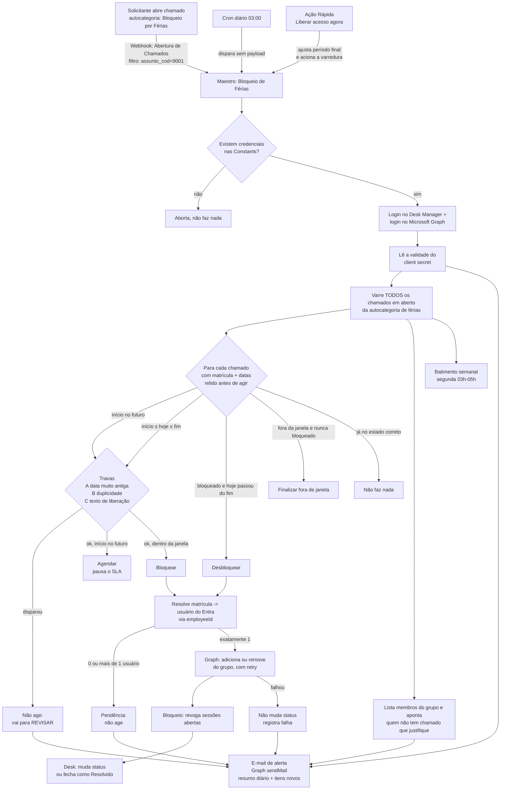
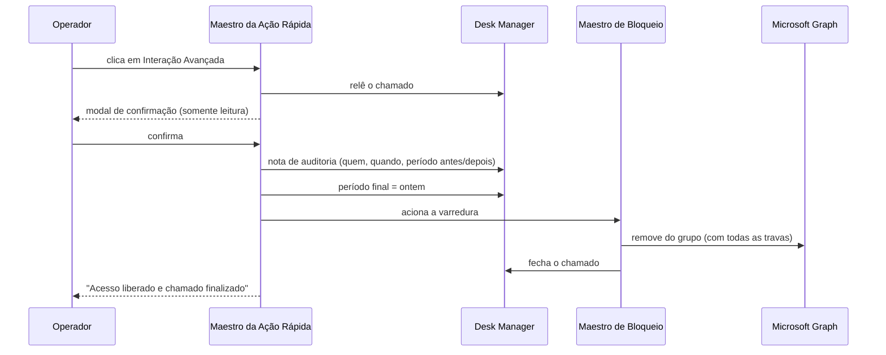

# Arquitetura

> Dados fictícios — ver aviso no [README](../README.md).

## Visão geral

### Ação Rápida "Liberar acesso agora"

## Componentes

| Componente | Papel |
|---|---|
| **Maestro de Bloqueio** | O fluxo principal. Tem 2 blocos: `BEGIN_init` (recebe o payload de entrada) → `PARSE_Registrar` (bloco Python com toda a lógica). |
| **Cron** | Dispara o Maestro uma vez por dia, sem payload (`{}`). Rede de segurança: mesmo que o webhook falhe, o cron trata tudo que estiver pendente. É também a rodada do **resumo diário** de alertas e do **batimento semanal**. |
| **Webhook** | Dispara o Maestro no evento "Abertura de Chamados", filtrado pela autocategoria de férias. Trata o chamado na hora, evitando que o SLA rode sem necessidade entre a abertura e a próxima execução do cron. |
| **Maestro da Ação Rápida** | Fluxo separado (`BEGIN_init` → `PARSE_Liberar`), ligado à Ação Rápida do chamado. Só altera o período final e aciona o Maestro de Bloqueio: nunca fala com o Entra ID. |
| **Constants do Maestro** | Guardam as credenciais (chave de API do Desk, client id/secret do Entra, id do grupo de bloqueio) e a URL de disparo da varredura. Nunca ficam no código do bloco. |
| **Microsoft Graph** | Grupo de bloqueio, revogação de sessões, listagem de membros, envio dos alertas e leitura da validade do secret. |

## Por que duas fontes de disparo (cron + webhook)

- **Só webhook** deixaria a automação cega a falhas silenciosas (webhook desativado sem querer,
  erro de rede pontual, etc.) — nada re-processaria o chamado depois.
- **Só cron** trataria a abertura do chamado com até 24h de atraso, correndo o risco de o SLA de
  primeiro atendimento estourar antes do bloqueio acontecer.
- Os dois disparam a **mesma varredura completa** (não um processamento por chamado individual),
  então rodar os dois ao mesmo tempo é seguro: cada chamado é relido do zero antes de qualquer
  ação, e a decisão é sempre baseada no estado atual, não em um evento específico.

## Decisões de design e lições aprendidas

- **Tipo do Cron importa.** A plataforma Desk Manager tem dois tipos de Cron: um que faz uma
  requisição HTTP "crua" (envia o corpo como texto) e um que invoca um Maestro nativamente (corpo
  como objeto). Na prática, o tipo "requisição HTTP crua" **marcava a execução como concluída sem
  de fato invocar o Maestro** nas condições usadas aqui — o sintoma era: nada nunca era desbloqueado
  ou bloqueado, sem nenhum erro visível. A correção foi recriar o cron usando o mesmo tipo/formato
  do outro cron do ambiente que já funcionava (invocação nativa de Maestro, corpo como objeto).
  **Lição:** ao depurar "o cron não fez nada", confira o *tipo* de cron e compare com um que já
  funciona no mesmo ambiente — não assuma que o disparo aconteceu só porque a plataforma marca a
  "próxima execução" corretamente.
- **Reler o chamado antes de agir.** Cada item da varredura é buscado de novo (não reaproveita o
  resultado da listagem) para confirmar autocategoria e status **no momento exato da ação** — evita
  agir em cima de dado desatualizado quando cron e webhook rodam perto um do outro.
- **Nunca agir em caso de ambiguidade.** Se a matrícula do colaborador casar com mais de um usuário
  no Entra ID (ex.: campo `employeeId` com formatação inconsistente, zeros à esquerda variando), a
  automação **não faz nada** e marca uma pendência — nunca bloqueia/desbloqueia "o mais provável".
- **Conferir o resultado do Graph antes de mudar o status no Desk.** Se a chamada ao Graph falhar
  (permissão insuficiente, usuário não encontrado, etc.), o chamado **não** é movido de status — a
  falha fica registrada, mas o processo não finge que o bloqueio aconteceu.
- **Revogar sessões, não só bloquear o login futuro.** Colocar o usuário num grupo bloqueado
  impede um *novo* login, mas não derruba sessões já abertas. Por isso o bloqueio também chama
  `revokeSignInSessions` do Microsoft Graph. Isso invalida os refresh tokens na hora; a aplicação
  cliente com token de acesso já emitido pode continuar válida por até a duração desse token (em
  geral até ~1h), a menos que o tenant tenha Continuous Access Evaluation habilitado.
- **Chamado aberto antes do início das férias não deve ficar com o SLA correndo.** Um chamado
  aberto dias antes do início ficaria "Aguardando Atendimento" (SLA correndo) até chegar a data.
  A automação resolve isso movendo o chamado para o status de **Agendamento** (que pausa o SLA na
  plataforma) assim que ele é aberto, e só volta a agir nele quando a data de início chega.
- **Pedido de liberação não é pedido de bloqueio.** Um chamado aberto na mesma autocategoria para
  *cancelar* um bloqueio foi lido pela automação como um novo pedido de bloqueio (agravado por um ano
  digitado errado) e bloqueou quem deveria ser liberada. Daí vieram as travas A, B e C e a detecção de
  órfãos. **Lição:** quando duas intenções opostas compartilham o mesmo formulário, a automação precisa
  de uma saída segura ("não agir e avisar"), não de um palpite.
- **Varredura completa mesmo com webhook.** Em invocação normal, o corpo do webhook *chega* ao Maestro.
  Se a automação trocasse para "tratar só aquele chamado", perderia a lista de abertos e, com ela, as
  travas de duplicidade e a detecção de órfãos. Por isso o chamado do webhook é só informação: a varredura
  é sempre completa.
- **Sandbox do Maestro: funções não enxergam o escopo externo.** Constantes, imports e até outras funções
  precisam ser passados por parâmetro ou importados dentro da função. Um `NameError` só aparecia
  quando o ramo raro (por exemplo, o do e-mail de alerta) executava.
- **Alerta sem estado, mas sem spam.** Sem onde guardar "já avisei", a regra por janela (resumo completo
  só na rodada diária; fora dela, só falhas gerais e itens novos do chamado do webhook) elimina o e-mail
  repetido a cada abertura de chamado sem depender de armazenamento.
- **Só o monitoramento externo pega a falha total.** Com o Graph fora, nem o alerta sai. O batimento
  semanal inverte a lógica: a *ausência* do e-mail é o sinal. O aviso de validade do secret cobre a causa
  mais comum de parada silenciosa (credencial vencida).
- **Ação Rápida reaproveita o fluxo, não o contorna.** Em vez de remover o usuário do grupo por conta
  própria, ela altera o período final e deixa a varredura fazer o resto. Assim, travas, retry e auditoria
  valem igualmente para a liberação manual, e há um único caminho de código que mexe no Entra ID.
- **Auditar quem fez o quê.** A nota grava o operador (código e nome), a hora e a mudança no período, com
  a instrução para desfazer. O nome é resolvido pela API a partir do código, pois a plataforma só
  entrega o código ao fluxo da Ação Rápida.
