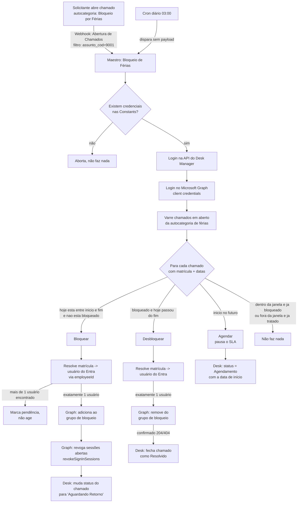

# Arquitetura

> Dados fictícios — ver aviso no [README](../README.md).

## Visão geral

## Componentes

| Componente | Papel |
|---|---|
| **Maestro** | O fluxo de automação. Tem 2 blocos: `BEGIN_init` (recebe o payload de entrada) → `PARSE_Registrar` (bloco Python com toda a lógica). |
| **Cron** | Dispara o Maestro uma vez por dia, sem payload (`{}`). Funciona como rede de segurança: mesmo que o webhook falhe, o cron trata tudo que estiver pendente. |
| **Webhook** | Dispara o Maestro no evento "Abertura de Chamados", filtrado pela autocategoria de férias. Trata o chamado na hora, evitando que o SLA rode sem necessidade entre a abertura e a próxima execução do cron. |
| **Constants do Maestro** | Guardam as credenciais (chave de API do Desk, client id/secret do Entra, id do grupo de bloqueio). Nunca ficam no código do bloco. |

## Por que duas fontes de disparo (cron + webhook)

- **Só webhook** deixaria a automação cega a falhas silenciosas (webhook desativado sem querer,
  erro de rede pontual, etc.) — nada re-processaria o chamado depois.
- **Só cron** trataria a abertura do chamado com até 24h de atraso, correndo o risco de o SLA de
  primeiro atendimento estourar antes do bloqueio acontecer.
- Os dois disparam a **mesma varredura completa** (não um processamento por chamado individual),
  então rodar os dois ao mesmo tempo é seguro: cada chamado é relido do zero antes de qualquer
  ação, e a decisão é sempre baseada no estado atual, não em um evento específico.

## Decisões de design e lições aprendidas

- **Tipo do Cron importa.** A plataforma Desk Manager tem dois tipos de Cron: um que faz uma
  requisição HTTP "crua" (envia o corpo como texto) e um que invoca um Maestro nativamente (corpo
  como objeto). Na prática, o tipo "requisição HTTP crua" **marcava a execução como concluída sem
  de fato invocar o Maestro** nas condições usadas aqui — o sintoma era: nada nunca era desbloqueado
  ou bloqueado, sem nenhum erro visível. A correção foi recriar o cron usando o mesmo tipo/formato
  do outro cron do ambiente que já funcionava (invocação nativa de Maestro, corpo como objeto).
  **Lição:** ao depurar "o cron não fez nada", confira o *tipo* de cron e compare com um que já
  funciona no mesmo ambiente — não assuma que o disparo aconteceu só porque a plataforma marca a
  "próxima execução" corretamente.
- **Reler o chamado antes de agir.** Cada item da varredura é buscado de novo (não reaproveita o
  resultado da listagem) para confirmar autocategoria e status **no momento exato da ação** — evita
  agir em cima de dado desatualizado quando cron e webhook rodam perto um do outro.
- **Nunca agir em caso de ambiguidade.** Se a matrícula do colaborador casar com mais de um usuário
  no Entra ID (ex.: campo `employeeId` com formatação inconsistente, zeros à esquerda variando), a
  automação **não faz nada** e marca uma pendência — nunca bloqueia/desbloqueia "o mais provável".
- **Conferir o resultado do Graph antes de mudar o status no Desk.** Se a chamada ao Graph falhar
  (permissão insuficiente, usuário não encontrado, etc.), o chamado **não** é movido de status — a
  falha fica registrada, mas o processo não finge que o bloqueio aconteceu.
- **Revogar sessões, não só bloquear o login futuro.** Colocar o usuário num grupo bloqueado
  impede um *novo* login, mas não derruba sessões já abertas. Por isso o bloqueio também chama
  `revokeSignInSessions` do Microsoft Graph. Isso invalida os refresh tokens na hora; a aplicação
  cliente com token de acesso já emitido pode continuar válida por até a duração desse token (em
  geral até ~1h), a menos que o tenant tenha Continuous Access Evaluation habilitado.
- **Chamado aberto antes do início das férias não deve ficar com o SLA correndo.** Um chamado
  aberto dias antes do início ficaria "Aguardando Atendimento" (SLA correndo) até chegar a data.
  A automação resolve isso movendo o chamado para o status de **Agendamento** (que pausa o SLA na
  plataforma) assim que ele é aberto, e só volta a agir nele quando a data de início chega.
